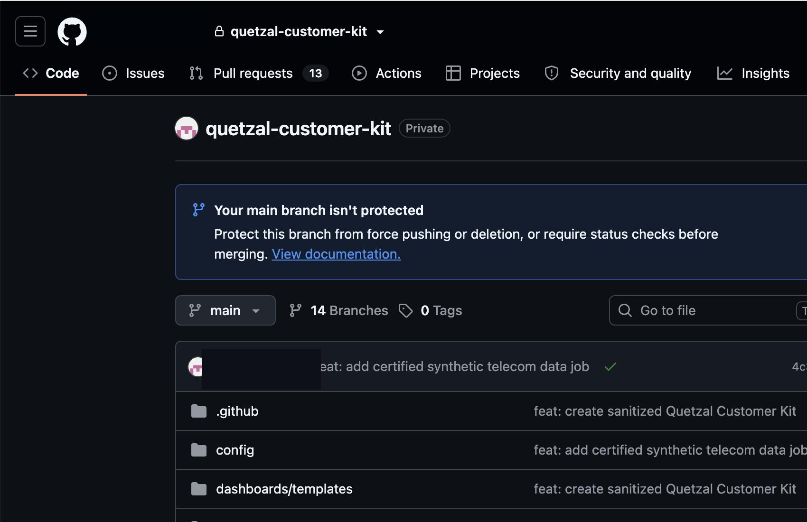

# Quetzal Customer Kit

Kit privado y reproducible para desplegar Quetzal en un workspace de Databricks controlado por el cliente. El repositorio contiene la aplicación React/FastAPI, Databricks Asset Bundle, la base de Terraform, contratos de datos y guías operativas.

## Acceso controlado al código

Antes de clonar el kit, confirme en GitHub que el repositorio aparece como **Private** y que solo los equipos autorizados tienen acceso. La visibilidad privada evita exponer la topología de despliegue, aunque no reemplaza la sanitización ni permite almacenar secretos en Git.



*Figura 1 — Repositorio privado. Compruebe la etiqueta **Private**; el nombre de usuario y otros datos de la sesión fueron ocultados deliberadamente.*

## Principios

- ningún host, ID, usuario, token ni dato del entorno de origen;
- Terraform administra la base; DAB administra los artefactos de Databricks;
- Unity Catalog y cómputo serverless de forma predeterminada;
- ningún job recurrente: bootstrap, memoria, alertas y grafo son manuales;
- los conectores y la investigación externa permanecen deshabilitados hasta recibir aprobación explícita;
- los datos reales nunca se almacenan en Git;
- producción cuenta con `prevent_destroy` y aprobación humana.

## Inicio rápido

Requisitos previos: Python 3.11+, Node.js 20+, Terraform 1.7+, Databricks CLI 0.229+ y un perfil OAuth del workspace de destino.

```bash
cp config/customer.env.example config/customer.env
cp terraform/environments/dev/dev.tfvars.example terraform/environments/dev/dev.tfvars

# Reemplace todos los valores de ejemplo antes de continuar.
make preflight
make sanitize

terraform -chdir=terraform/environments/dev init
terraform -chdir=terraform/environments/dev plan -out=tfplan
terraform -chdir=terraform/environments/dev apply tfplan

make frontend-build
make bundle-validate TARGET=dev
make bundle-deploy TARGET=dev
make synthetic-data TARGET=dev
make data-contract TARGET=dev
make bootstrap TARGET=dev
make memory TARGET=dev
```

`synthetic-data` ejecuta un único job serverless manual con dos tareas: generación y certificación. La ejecución falla si los volúmenes, esquemas, claves, reglas contables, seguridad de la PII ficticia o cobertura de los recorridos de la demo son incorrectos. Para fuentes reales, no ejecute este job: implemente los adaptadores del modo `customer`.

El grafo está separado de forma intencional y solo debe ejecutarse cuando sea necesario generar un nuevo snapshot:

```bash
make graph TARGET=dev
```

## Modos de datos

- `synthetic`: fuentes de telecomunicaciones deterministas, sin PII real, para demostraciones y pruebas.
- `customer`: vistas de adaptación implementadas por el cliente sobre sus fuentes gobernadas.

El contrato canónico se encuentra en `data_contracts/`. El despliegue de la aplicación no concede acceso automático a las fuentes del cliente.

## Orden de lectura

1. [Descripción general](docs/00-overview.md)
2. [Requisitos previos](docs/01-prerequisites.md)
3. [Terraform](docs/02-terraform.md)
4. [Despliegue con DAB](docs/03-dab-deploy.md)
5. [Bootstrap](docs/04-bootstrap.md)
6. [Validación](docs/05-validation.md)
7. [Operación](docs/06-operations.md)
8. [Seguridad](docs/07-security.md)
9. [Trazabilidad de las capturas utilizadas en las guías](docs/screenshots/README.md)

## Componentes

```text
Base Terraform
  └─ grupos, catálogo/esquema, permisos y SQL Warehouse

Databricks Asset Bundle
  ├─ Databricks App
  ├─ dashboard AI/BI
  ├─ espacios Genie
  ├─ vinculación de base de datos Lakebase
  └─ jobs manuales

Aplicación Quetzal
  ├─ React + TypeScript
  ├─ FastAPI
  ├─ Unity Catalog / Databricks SQL
  ├─ Unity AI Gateway
  ├─ Lakebase + Managed Agent Memory
  └─ contrato OntoBricks
```

## Soporte

Abra una issue privada con el resultado de `make sanitize`, `make bundle-validate` y el identificador de la ejecución fallida. Nunca incluya tokens, PII ni archivos de state.
