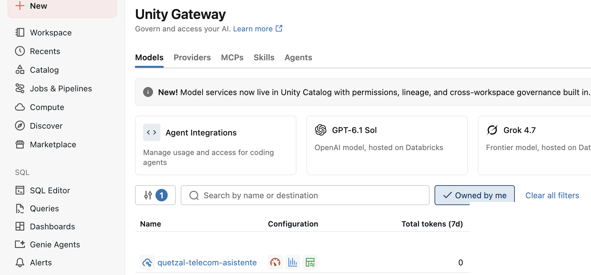

# Despliegue con Databricks Asset Bundles

## Configuración

```bash
cp config/customer.env.example config/customer.env
make preflight
make render
```

`render` inyecta el catálogo, el esquema y la URI de la ontología únicamente en los artefactos generados. Las plantillas versionadas permanecen neutrales.

## Validación y despliegue

```bash
make frontend-build
make bundle-validate TARGET=dev
make bundle-deploy TARGET=dev
```

Los IDs de la aplicación, el dashboard, los espacios Genie y los jobs se resuelven mediante referencias del bundle. No copie IDs de otro workspace ni utilice una sincronización manual como etapa final.

## Comprobar Unity AI Gateway

Después del despliegue, abra el endpoint de modelo que utiliza Quetzal IQ y entre en **AI Gateway**. Confirme que el gateway está habilitado para el endpoint correcto y que las funciones de seguimiento y gobernanza previstas por el cliente aparecen activas. No copie el endpoint ni sus identificadores desde el entorno de origen: deben resolverse mediante la configuración del workspace de destino.



*Figura 1 — Unity AI Gateway configurado. Verifique el estado habilitado y las capacidades de gobernanza; el hostname, los IDs y la identidad del operador fueron ocultados.*

Esta verificación demuestra la configuración del gateway, no una respuesta funcional. La prueba de Quetzal IQ se realiza en la [validación de la aplicación](05-validation.md#quetzal-iq-con-fuentes).

## Promoción

Utilice un `config/customer.env` específico por entorno y un GitHub Environment protegido para `staging` y `prod`. El workflow de despliegue es manual y utiliza OIDC; no almacene un PAT ni un secreto de cliente en el repositorio.
