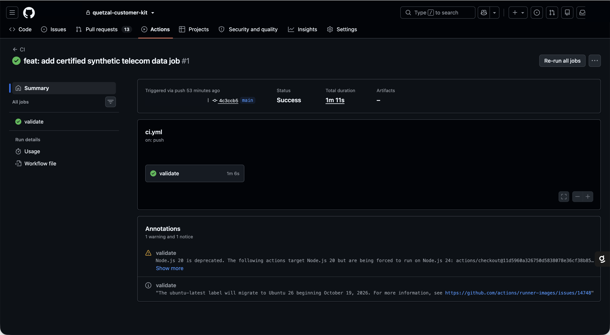
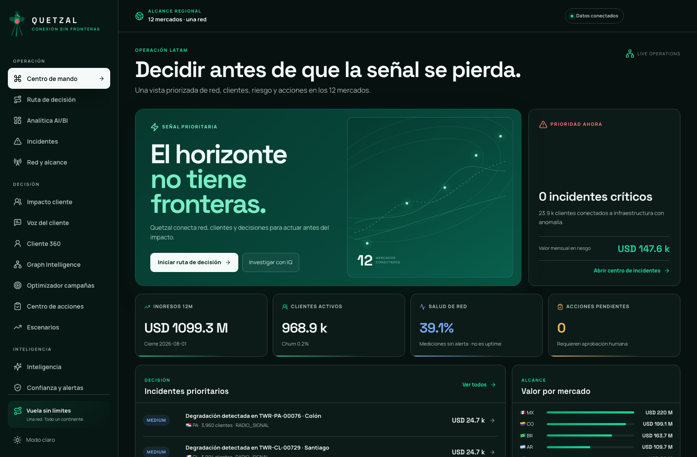
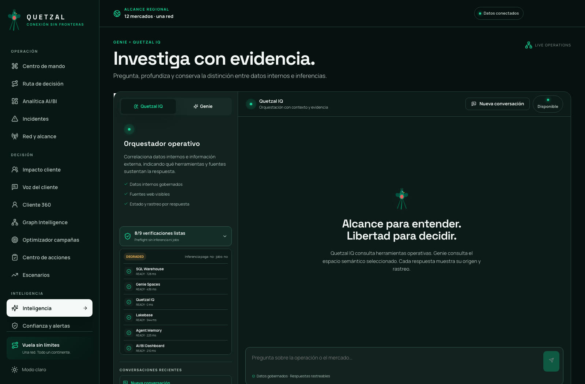
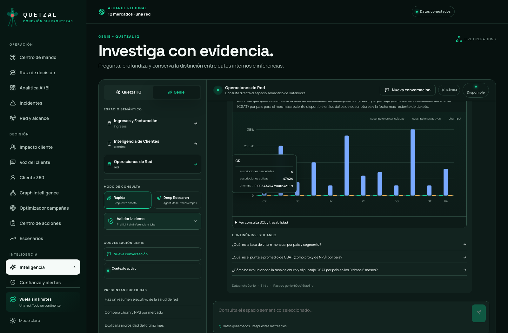
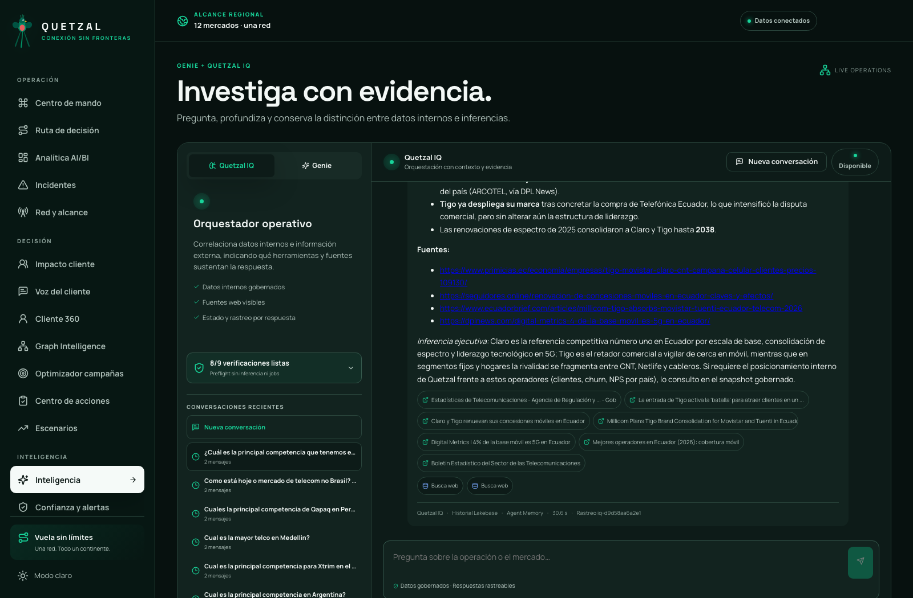
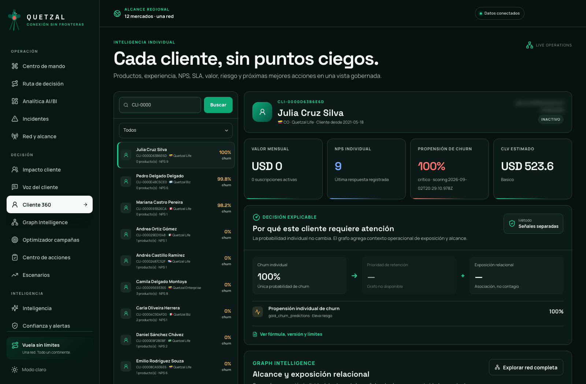

# Validación

## Validación local y CI

```bash
make sanitize
python -m pytest -q
make frontend-build
terraform -chdir=terraform/environments/dev fmt -check -recursive
terraform -chdir=terraform/environments/dev validate
make bundle-validate TARGET=dev
```

La siguiente captura sirve como referencia del resultado esperado en GitHub Actions. Antes de promover un cambio, ejecute el workflow y compruebe que el commit candidato aparece en verde:



*Figura 1: pipeline aprobado con verificación de seguridad, pruebas, auditorías de dependencias, build del frontend y validación de Terraform.*

## Certificación de datos sintéticos

```bash
make synthetic-data TARGET=dev
```

El job contiene dos tareas encadenadas. La primera genera las fuentes y derivaciones; la segunda bloquea el éxito hasta comprobar:

- conteos y esquemas esperados;
- claves primarias e integridad referencial;
- PII exclusivamente ficticia y no enrutable;
- coherencia de fechas, facturas, NPS, telemetría y churn;
- cobertura de Cliente 360, SLA, retención, campañas, Voz del Cliente e incidentes de red;
- propiedades `data_classification=synthetic` y `generated_by=quetzal-customer-kit`;
- fingerprint estable para los mismos `customer_count`, `seed` y `anchor_date`.

Una ejecución en verde es la evidencia funcional del dataset. `bundle validate` por sí solo únicamente comprueba la configuración de DAB.

## Aplicación desplegada

Abra la URL generada por Databricks Apps. La página inicial debe cargar sin errores, mostrar la navegación de Quetzal y mantener texto legible tanto en tema claro como oscuro. En Databricks, confirme además que el recurso de la aplicación está en estado `RUNNING`.



*Figura 2: Quetzal desplegado y operativo. Revise la navegación, la legibilidad y la ausencia de errores visibles.*

## Validación de capacidades

En la aplicación, abra **Inteligencia** y ejecute la validación de capacidades. Warehouse, Genie, AI Gateway, Lakebase, Managed Agent Memory, AI/BI, RBAC y Graph Intelligence deben mostrar su estado real. Un componente no configurado debe aparecer como advertencia explícita.



*Figura 3: validación de capacidades. Compruebe qué componentes están listos antes de utilizar el flujo integrado.*

## Genie con visualización

Seleccione **Genie**, pulse **Nueva conversación** y formule una pregunta analítica que produzca datos agrupados, por ejemplo: `Compara churn y NPS por mercado`. La respuesta debe conservar el texto de Genie, la consulta rastreable y un gráfico interactivo; al pasar el puntero por una marca debe aparecer su valor. La pestaña **Datos** debe mostrar las filas que sustentan la visualización.



*Figura 4: respuesta de Genie. Verifique la conversación, la consulta generada, los datos y el gráfico interactivo.*

## Quetzal IQ con fuentes

Cambie a **Quetzal IQ** y realice una pregunta que exija información externa, por ejemplo: `¿Cuál es la principal competencia que tenemos en Ecuador?`. La respuesta debe distinguir fuentes web de snapshots internos, presentar enlaces consultables y conservar el contexto en una pregunta de seguimiento. Si la investigación externa está deshabilitada, Quetzal debe informarlo claramente en vez de reemplazarla por una consulta interna no relacionada.



*Figura 5: Quetzal IQ con trazabilidad. Compruebe la respuesta, las fuentes externas visibles y el motor utilizado.*

## Cliente 360

Abra un cliente sintético desde la búsqueda o desde una recomendación. Verifique que la vista reúne identidad ficticia, suscripciones, experiencia, NPS, SLA, churn individual, contexto relacional y productos recomendados. El usuario solo debe ver países autorizados y una oferta nunca debe activarse sin consentimiento ni decisión humana.



*Figura 6: Cliente 360. Revise que riesgo, SLA, productos y recomendaciones pertenezcan al mismo cliente ficticio y respeten el alcance territorial.*

## Lista final de aceptación

1. Job sintético en `SUCCEEDED`, con la tarea de certificación concluida.
2. Aplicación en estado `RUNNING` y página inicial accesible.
3. Validación sin capacidades críticas ausentes.
4. Genie crea una nueva conversación, responde y renderiza un gráfico interactivo.
5. Quetzal IQ mantiene el contexto y diferencia los datos internos de la investigación externa.
6. Cliente 360 respeta el alcance territorial y el consentimiento.
7. El dashboard AI/BI carga dentro de la aplicación.
8. Graph Intelligence solo se inicia mediante el botón administrativo.
9. Voz del Cliente y el Optimizador de Campañas no ejecutan comunicaciones reales.

El [índice de capturas](screenshots/README.md) describe la pantalla y el resultado esperado de cada figura.
